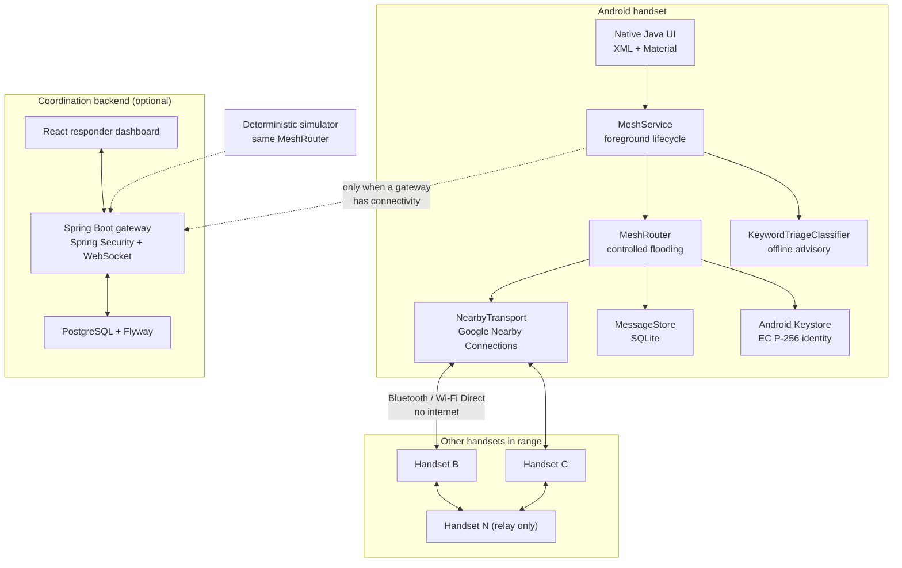
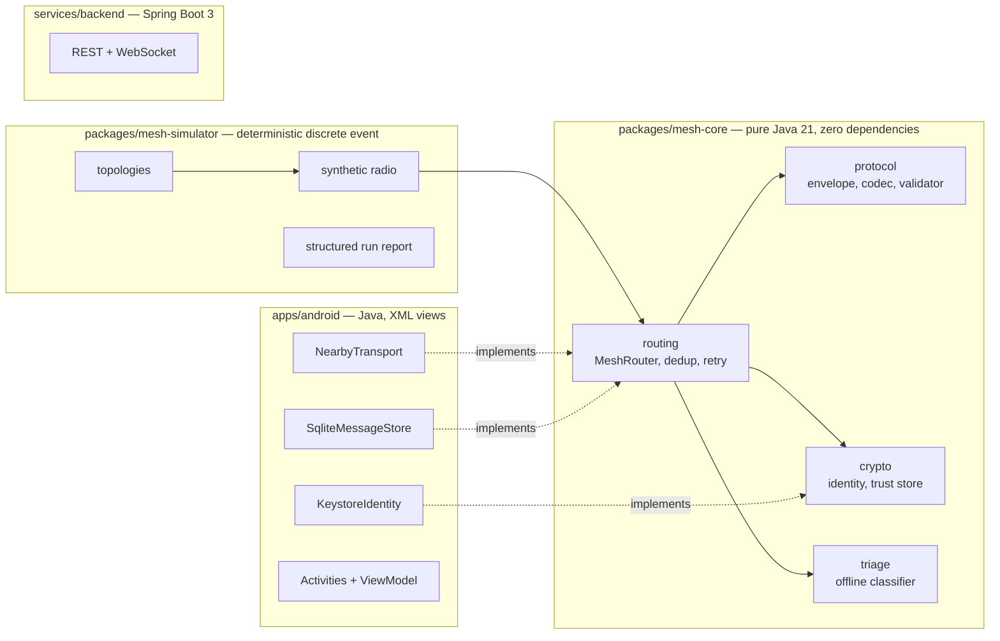
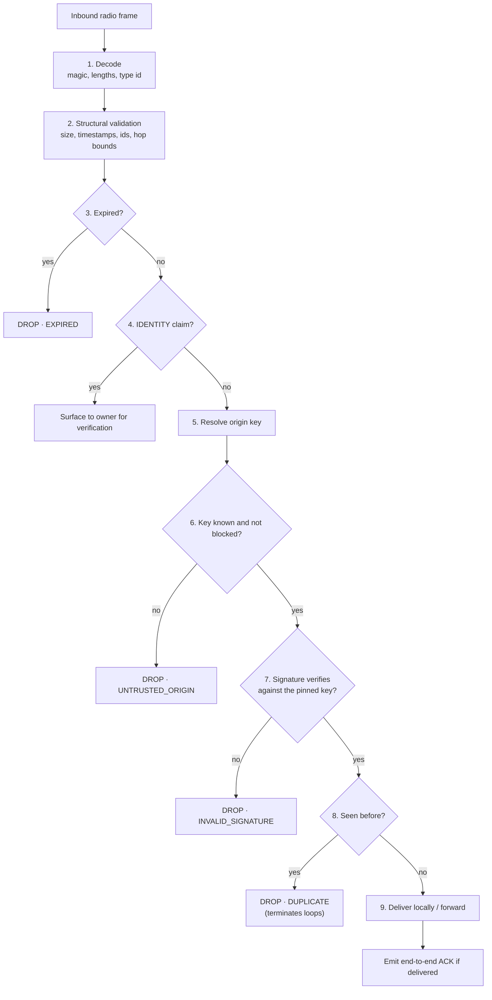
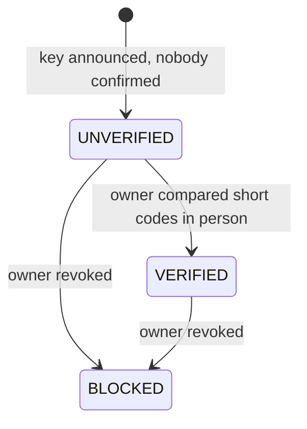

# ResQNet System Architecture

This document describes how ResQNet is put together and, more importantly, *why*.
Every design decision below is a trade-off that was made against a specific
alternative, and the reasoning is recorded so a future maintainer can tell the
difference between a considered choice and an accident.

---

## 1. The problem, stated honestly

When infrastructure fails, the failure is not uniform. Cell towers lose power
first, then backhaul, then the internet itself. But Bluetooth and Wi-Fi Direct
keep working, because they need no infrastructure at all. The radios are in the
phones. The batteries are in the phones. The people who need to talk to each
other are holding the phones.

What is missing is the layer that makes those radios useful to each other.

ResQNet is that layer.

## 2. Constraints that drive every decision

| Constraint | Consequence |
| --- | --- |
| No internet, no cloud, no Firebase | The emergency network cannot depend on a server to function |
| Phones die | Every protocol decision must assume nodes vanish without warning |
| Radios are the bottleneck | Bandwidth and battery are scarcer than CPU |
| Peers are untrusted | Anything within radio range may be hostile |
| Users are in distress | Nothing essential may depend on the UI being rendered |
| We cannot field-test at scale | The simulator must run the *same* code as the phone |

## 3. Component map



The dashed links are the only paths to the backend, and both are optional. Cut
every one of them and the emergency network keeps working; it simply stops
reporting to the responder dashboard.

## 4. Module boundaries

The repository is a monorepo with one hard rule: **domain logic never imports a
UI framework**.



`mesh-core` has no dependency on Android, on Spring, or on any third-party
library. It compiles against the JDK alone. That is what makes the following
statement true rather than aspirational:

> The multi-hop routing behaviour verified by the simulator is the same
> behaviour a handset exhibits, because it is the same `MeshRouter` class.

## 5. Why controlled flooding

The mesh is a dozen or so phones in a valley. Nobody knows the route to anybody.
Topologies change when someone walks behind a building. Batteries die.

Table-driven alternatives (DSR, AODV, GPSR, Babel) all require either a link
state the mesh cannot maintain or a routing table that costs battery to keep
correct and goes stale the moment a screen locks. At this scale, the cost of
maintaining topology exceeds the cost of flooding.

Controlled flooding needs no topology. Each message is forwarded by a node at
most once, enforced by a bounded duplicate cache, and travels at most
`hopLimit` hops. With a fan-out cap and a per-origin forwarding allowance, the
total work is bounded by:

```
forwards ≤ (number of nodes in range) × hopLimit × fanOut
```

### 5.1 The receive pipeline

The order of these checks is a security boundary, not a style choice.



Two orderings deserve comment because getting them wrong is catastrophic:

- **Deduplication runs *after* authentication.** If it ran first, an
  unauthenticated attacker could inject an envelope carrying a victim's message
  id, poison the cache, and permanently suppress the real message.
- **Acknowledgements are forwarded like any other envelope.** There is no reverse
  route in a mesh; the ACK floods back along whatever path exists. ACKs are
  exempt from generating ACKs, which is what stops the two from oscillating.

### 5.2 Split horizon

An envelope is never handed back to the peer it arrived from. On a phone with
four neighbours this removes the most common two-node loop and a large fraction
of the redundant radio traffic a naive flood would produce.

## 6. Delivery semantics

This is the distinction the entire product rests on.

```mermaid
stateDiagram-v2
    [*] --> CREATED
    CREATED --> QUEUED : persisted before first send
    QUEUED --> SENT_TO_PEER : radio handover succeeded
    SENT_TO_PEER --> ACKNOWLEDGED : destination confirmed receipt
    SENT_TO_PEER --> QUEUED : no confirmation; retry with backoff
    QUEUED --> EXPIRED : lifetime elapsed
    QUEUED --> FAILED : retry budget exhausted
    SENT_TO_PEER --> RELAYED : this node is relaying, not originating
    RELAYED --> ACKNOWLEDGED : end-to-end confirmed
    RELAYED --> EXPIRED : lifetime elapsed
```



`SENT_TO_PEER` means exactly one thing: bytes were handed to a radio. It is not
evidence that any human read anything. The Android UI is required to present
these states differently, and the responder dashboard must never report a
message as delivered on the basis of a hop count.

## 7. Store and forward

A message composed while every peer is out of range must survive until a peer
returns, survive the process being killed, and survive the phone being powered
off.

The write happens **before** the first send attempt. If the process dies between
"user pressed send" and "radio handed over the frame", the message still exists,
because from the user's point of view they sent it.

Retry uses exponential backoff with **full jitter**, capped, with a finite
attempt budget. One deliberate exception: when a peer *connects*, the backoff
schedule is bypassed. Backoff exists to stop a node burning its battery retrying
into a dead network; it must not stop a node using a link that just appeared.

### What Android will not let us promise

`WorkManager` gives a best-effort window, not a guarantee. Doze, App Standby,
battery optimisation and OEM task killers can all terminate or defer work without
notice. ResQNet therefore:

- runs a foreground service with a persistent notification while the mesh is
  active, so the system treats it as user-visible;
- relies on the OS to resume the service on reboot;
- persists everything, so a cold start resumes mid-queue;
- **does not claim continuous operation after the OS terminates the app.**

Documented honestly in `docs/architecture/android-lifecycle.md`.

## 8. Identity and trust

A Nearby Connections endpoint id is a per-session radio handle. It changes when
the device reboots, moves between radios, or when the OS decides it has. Using
it as an identity would mean that the same person is a different person
tomorrow.

ResQNet device ids are therefore:

```
deviceId = "rqn1_" + hex( SHA-256( X.509( publicKey ) ) )
```

Keys are ECDSA P-256, generated in the Android Keystore where available. The
trust model has three states and no shortcuts:

A Nearby endpoint is mapped to a stable device id only after a fresh, one-use
challenge on that connection is signed by the claimed device key. This link
proof is separate from the human decision to verify a peer. A newly proved key
remains `UNVERIFIED` until its short code is compared in person.



Traffic from an unknown origin is rejected outright. There is no trust-on-first
use, because in an emergency mesh a single spoofed SOS could divert scarce
responders. Devices you have never met can still tell you a flood is coming —
they just cannot impersonate the responder you already verified.

Full analysis in `docs/security/threat-model.md`.

## 9. Bounding the damage

Every bound in `RouterConfig` exists because mesh traffic is attacker-reachable.
An unbounded queue is a memory exhaustion vector; an unbounded fan-out is a
battery exhaustion vector; an unbounded lifetime is a storage exhaustion vector.

| Bound | Default | Defends against |
| --- | --- | --- |
| Envelope size | 16 KiB encoded / 8 KiB payload | Memory exhaustion |
| Hop limit | 6 (max 32) | Flood loops, range abuse |
| Lifetime | 15 min (max 6 h) | Storage exhaustion |
| Duplicate cache | 4096 entries / 8 MiB / 6 h | Replay, cache poisoning |
| Fan-out | 8 peers | Battery exhaustion |
| Queue capacity | 512 records, SOS protected | Storage exhaustion |
| Per-origin forward rate | 8/s, burst 16, **SOS exempt** | Bandwidth exhaustion |

Life-safety traffic is deliberately exempt from throttling. Suppressing a
genuine SOS is strictly worse than accepting some extra work, and the flood is
still bounded by hop limits, deduplication and the fan-out cap.

## 10. Deterministic simulation

The simulator is not a mock. It constructs real `MeshRouter` instances with real
keys, real signatures and real validation, and connects them with a synthetic
radio driven by an injected clock and a seeded RNG.

Consequences:

- a topology test that passes in the simulator is a statement about the phone;
- a failure found at 10^6 simulated seconds replays exactly from its seed;
- the benchmark numbers in `docs/benchmarks/` are reproducible rather than
  anecdotal.

## 11. The backend's actual job

The coordination gateway is **not** part of the emergency network. It is a
reporting surface that becomes useful the moment some device has connectivity.

- A gateway device synchronises incident summaries over TLS when it can.
- The backend verifies the gateway's key, never the sender's self-declared role.
- Responder roles are assigned by a human administrator. Clients cannot promote
  themselves; a gateway cannot mint responder credentials.
- Everything a responder does is written to an append-only audit trail.

## 12. What is deliberately absent

| Not included | Why |
| --- | --- |
| End-to-end payload encryption | Signatures authenticate; they do not conceal. Claiming encryption we have not independently validated would be worse than not claiming it. |
| Automatic responder dispatch | Advisory classification only. Nothing here decides that a person should be sent anywhere. |
| Continuous background guarantees | Android does not permit them, and pretending otherwise is a safety problem. |
| Location by default | Location is user-controlled, per message, and never broadcast implicitly. |
