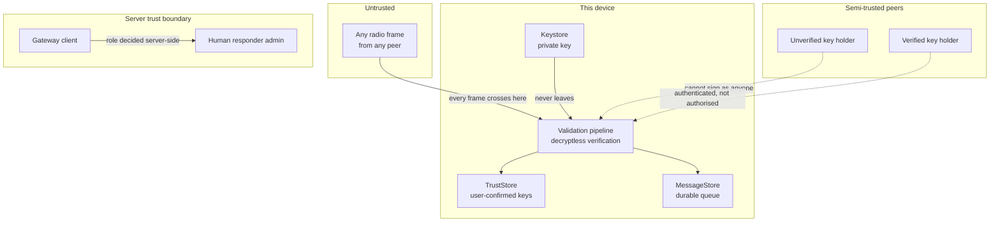

# Threat Model

ResQNet is safety-adjacent software. A design flaw here does not merely leak
data; it can misdirect a rescue. This document states what the system defends
against, what it deliberately does not, and where the residual risk sits.

Scope: the mesh protocol and routing engine (`packages/mesh-core`), the Android
transport adapter, and the coordination gateway.

---

## 1. Assets

Ordered by how much damage their compromise would cause.

| # | Asset | Why it matters |
| --- | --- | --- |
| A1 | Integrity of an SOS | A forged or altered rescue request sends scarce responders to the wrong place |
| A2 | Authenticity of a device identity | Without it, any phone can claim to be a verified responder |
| A3 | Availability of the mesh | A dead battery during a flood is a death |
| A4 | Integrity of responder actions | An audit trail that can be rewritten is worthless |
| A5 | Confidentiality of location | Being located can endanger people, especially survivors |
| A6 | Availability of the coordination backend | Affects situational awareness, not the emergency network |

Note what is **not** an asset: the content of ordinary messages. ResQNet does not
claim confidentiality and does not pretend to provide it.

## 2. Adversaries

### D1 — Opportunistic eavesdropper within radio range
Has a phone, no special access, can see broadcast frames. May capture and replay
bytes.

### D2 — Malicious participant
Has joined the mesh legitimately, has been given a key, and then abuses the
protocol: floods, replays, or forwards selectively to make a victim believe a
message was delivered when it was not.

### D3 — Impersonator
Wants to send messages as a verified responder or as a specific person, without
that person's key.

### D4 — Compromised device
Has extracted a private key from a lost or seized handset.

### D5 — Network attacker
Operates the Wi-Fi access point, or the cell tower, in the affected area.

### D6 — Insiders at the coordination backend
Has database access or backend credentials.

## 3. Trust boundaries

The boundary between **authenticated** and **authorised** is load-bearing. A
message with a valid signature proves *who sent it*. It never proves that they
should have been permitted to send it, and no client-supplied field is ever
treated as an authorisation claim.

## 4. Threats and mitigations

### T1 — Forged SOS (A1, A2) · D3
*An attacker crafts a message that appears to come from a verified responder.*

**Mitigation.** Every envelope carries a signature over a canonical byte string
that includes the origin device id, the origin key fingerprint, the destination,
the timestamps, and the payload. Verification binds the signature to the pinned
fingerprint and to the claimed device id. Rewriting the origin field invalidates
the signature.

**Tests.** `SecurityTest.dropsOriginSubstitution`,
`SecurityTest.dropsTamperedPayload`.

### T2 — Replay of a captured frame (A1) · D1
*A captured genuine SOS is re-injected later, generating a duplicate alert.*

**Mitigation.** A bounded duplicate-suppression window keyed by message id, run
*after* authentication so it cannot be poisoned by unauthenticated input. The
window expires with the message lifetime, so a replay of an expired message is
refused on the expiry check first.

**Tests.** `SecurityTest.dropsReplay`, `DuplicateCacheTest`.

### T3 — Amplification / battery exhaustion (A3) · D2
*A single node floods every device in range.*

**Mitigation, four layers.** Hop limits cap total distance. Deduplication caps
per-node forwarding to once per message. A fan-out cap limits each node's radio
transmissions per message. A per-origin token bucket limits sustained inbound
forwarding work.

Life-safety traffic is exempt from the token bucket by deliberate choice;
suppressing a real SOS is worse than extra work, and the flood is still bounded
by the other three layers.

**Tests.** `SecurityTest.throttlesFlooding`, `SecurityTest.doesNotThrottleLifeSafety`.

### T4 — Queue exhaustion (A3) · D2
*The queue fills and legitimate SOS traffic is evicted.*

**Mitigation.** Hard capacity bound with priority-ordered eviction. SOS records
are never evicted; the oldest low-priority record goes first.

**Tests.** `StoreAndForwardTest.enforcesCapacityProtectingSos`,
`InMemoryMessageStoreTest.neverEvictsSos`.

### T5 — Oversized or malformed frames (A3, A6) · D1, D2
*A frame declares an enormous length to exhaust memory.*

**Mitigation.** Declared lengths are checked against the remaining buffer before
any allocation. Payload and envelope ceilings are enforced in both directions.
The decoder is fuzzed in tests by corrupting every four-byte window.

**Tests.** `EnvelopeCodecTest.rejectsHostileLengthPrefix`,
`EnvelopeCodecTest.rejectsTruncation`.

### T6 — Spoofed responder role (A2, A4) · D2, D6
*A gateway client claims responder privileges for itself.*

**Mitigation.** No client can assign itself a role. The backend issues
credentials to authenticated human accounts; a gateway is authenticated by its
key and is scoped to *synchronise*, never to *authorise*. Role checks happen
server-side against the account record, never against request payloads.

### T7 — False delivery confirmation (A1) · D2
*An attacker relays only acknowledgements so the sender believes a message
arrived when it did not.*

**Mitigation.** Acknowledgements are themselves signed envelopes addressed to
the specific origin. A relay cannot forge one: the fingerprint is pinned to the
destination's key and the signature must verify. A message is only ever shown as
`ACKNOWLEDGED` when a signature from the intended recipient verifies.

**Tests.** `AcknowledgementTest.reachesAcknowledged`,
`AcknowledgementTest.relayDoesNotClaimDelivery`.

### T8 — Stolen device keys (A2) · D4
*A lost handset yields a usable identity.*

**Mitigation.** Keys live in the Android Keystore where the hardware permits,
bound to the device and non-exportable on many devices. Beyond that: users can
revoke a peer on any device, and a revoked key is refused everywhere the trust
store is loaded. Key theft from a physical device is **not** fully mitigated —
see Residual risks.

### T9 — Location exposure (A5) · D1, D5
*Precise location of a survivor leaks to the network or an unknown peer.*

**Mitigation.** Location is never transmitted implicitly. It is user-controlled,
per message, coarse by default, and omitted entirely unless the sender attaches
it. The protocol has no location field; location rides inside an encrypted-by-
transport payload the sender chose to send. The system makes no claim of
end-to-end confidentiality for that payload.

### T10 — Backend compromise (A6, A4) · D6
*An insider rewrites responder audit records.*

**Mitigation.** Audit events are append-only, written with the acting account,
and exported to a separate sink. A responder cannot edit or delete an audit
record; only an administrative export is possible.

### T11 — Untrusted identity announcement (A2) · D3
*An attacker announces a key for a known peer's identity.*

**Mitigation.** Announcements carry no authority. They produce a prompt in the
owner's UI, showing an eight-character code. Only a human comparison populates
the trust store. Because the device id is a hash of the key, an announcement for
a known id necessarily carries that exact key, so substitution is structurally
impossible.

**Tests.** `SecurityTest.unsignedIdentityClaimGrantsNothing`,
`SecurityTest.deviceIdIsBoundToItsKey`.

### T12 — Nearby peer identity rebinding (A2, A3) · D1, D3
*An attacker replays a known device's public identity announcement on a new
Nearby endpoint to capture messages addressed to that device.*

**Mitigation.** An announcement only records an unverified key. Each connected
endpoint stays provisional until it answers a fresh 256-bit random challenge
with a signature from the claimed identity's private key. The signed bytes
include a protocol domain, challenger and claimant identities, and the nonce.
The verifier accepts the answer only on the endpoint where it issued that
challenge, within 15 seconds, once, while that connection remains active.
Disconnect, stop, failed verification, and timeout discard pending proof.
A blocked identity cannot be promoted. A successful proof identifies a key
holder; it does not change the user's UNVERIFIED or VERIFIED trust decision.
Identity announcements and mesh envelopes still route while a link is
provisional.

**Tests.** `LinkIdentityProofTest` covers possession, replay, wrong signatures,
endpoint swaps, timeout and interruption. `IdentityRebindingTest` checks that
an announcement alone cannot bind a known identity. `PeerBindingsTest` checks
replacement and removal of stale endpoint mappings. These are logic and
Android adapter tests, not evidence about physical radio delivery.

## 5. Residual risks

Stated plainly, because a threat model that claims completeness is not a threat
model.

| Risk | Why it remains | Mitigation in practice |
| --- | --- | --- |
| R1 — Physical key extraction | A rooted device or an unlocked bootloader can defeat the Keystore | Revocation; short message lifetimes limit the window |
| R2 — No payload confidentiality | Signatures authenticate, they do not encrypt | Documented explicitly; payload encryption is a roadmap item, not a claim |
| R3 — Global eclipse attack | A radio-level attacker could jam discovery | Requires spectrum access beyond the threat scope of a single app |
| R4 — First-contact trust is unavailable | Devices that have never met cannot authenticate each other, so traffic between them is refused | Deliberate. Identification is an in-person act; this is the honest trade |
| R5 — Classification errors | The offline classifier can be wrong | Confidence is reported, results are advisory, manual override is always available |
| R6 — Background execution limits | Android can suspend or kill the app | Documented; store-and-forward recovers on relaunch |
| R7 — Live relay of a proof exchange | An attacker with simultaneous access to the real key holder can forward a live challenge and answer; the protocol does not establish physical proximity or prevent radio relay attacks | Treat a proof as key possession at the end of the byte pipe, not as distance evidence; validate the link on real devices and retain human fingerprint verification |

## 6. Reporting

See `SECURITY.md` at the repository root.

## 7. Non-goals

- **Not a replacement for official emergency services.** Call your local
  emergency number. ResQNet is a prototype communications aid.
- **Not certified for any safety standard.** No IEC 61508, ISO 26262 or medical
  certification is claimed or implied.
- **Not an anonymity system.** Traffic analysis defeats any claim in that
  direction, and none is made.
